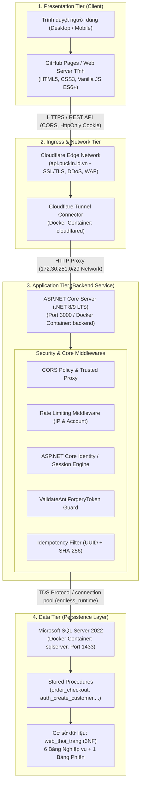
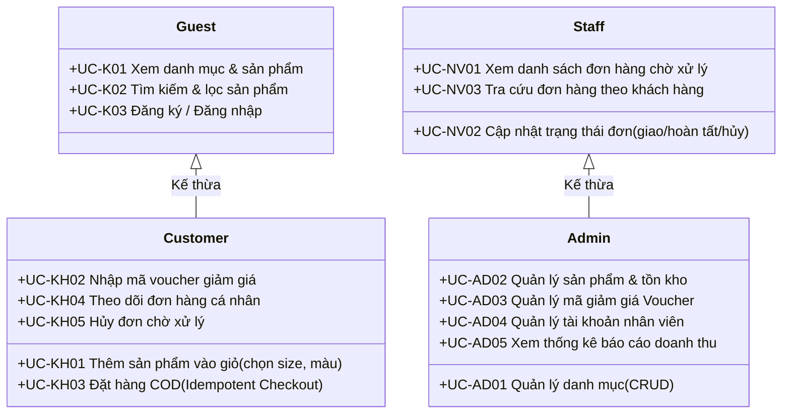
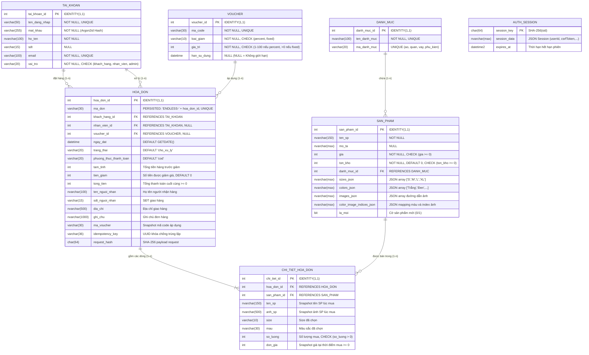
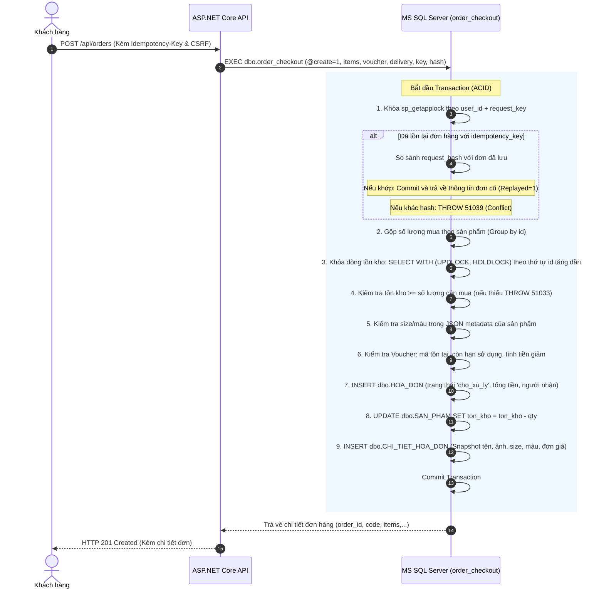
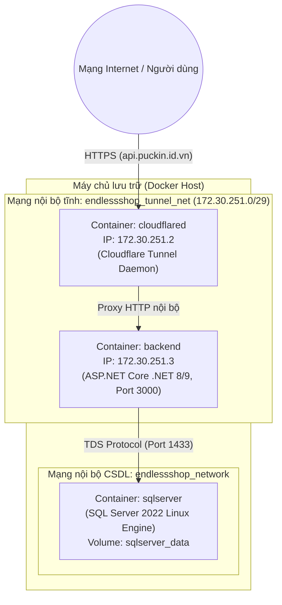

# TÀI LIỆU THIẾT KẾ KỸ THUẬT HỆ THỐNG (TECHNICAL DESIGN DOCUMENT)
## DỰ ÁN: WEBSITE THƯƠNG MẠI ĐIỆN TỬ THỜI TRANG (ENDLESS SHOP)

---

### THÔNG TIN TỔNG QUAN DỰ ÁN
- **Tên dự án:** Website Thời Trang Trực Tuyến - EndLess Shop
- **Đơn vị thực hiện:** Nhóm 5
- **Công nghệ cốt lõi chính thức (Technology Stack):**
  - **Giao diện (Frontend):** HTML5, CSS3, Vanilla JavaScript (ES6+), Responsive Web Design (Mobile & Desktop).
  - **Phía máy chủ (Backend):** C# / ASP.NET Core (.NET 8/9 LTS Web API & Controller).
  - **Cơ sở dữ liệu (Database):** Microsoft SQL Server 2022 (MS SQL) với T-SQL, Stored Procedures, Constraints và Transaction ACID.
  - **Môi trường & Đóng gói (DevOps):** Docker, Docker Compose (Container hóa Backend và SQL Server).
  - **Cổng phân phối & Mạng (Network & Ingress):** Cloudflare Tunnel (`cloudflared`) mã hóa HTTPS đầu-cuối, GitHub Pages (Frontend Hosting).
- **Mục tiêu tài liệu:** Đặc tả chi tiết toàn bộ kiến trúc kỹ thuật, mô hình hóa luồng dữ liệu, phân rã use case, thiết kế cơ sở dữ liệu vật lý (3NF), giao thức API, cơ chế bảo mật và phương án triển khai của hệ thống website thương mại điện tử EndLess Shop.

---

## 1. TỔNG QUAN HỆ THỐNG VÀ PHẠM VI (SYSTEM OVERVIEW & SCOPE)

### 1.1. Bối cảnh & Phát biểu bài toán
Trong kỷ nguyên bùng nổ của thương mại điện tử (D2C - Direct to Consumer & B2C), việc mua sắm thời trang trực tuyến đòi hỏi tính tiện lợi, trực quan và tốc độ xử lý tức thì. Cửa hàng truyền thống gặp rào cản địa lý và chi phí vận hành lớn, đồng thời việc quản lý đơn hàng, tồn kho thủ công dễ phát sinh sai sót.

**Phát biểu bài toán:** Xây dựng hệ thống website thương mại điện tử chuyên ngành thời trang đa nền tảng, cung cấp trải nghiệm duyệt đồ, chọn size/màu, đặt hàng COD mượt mà cho khách hàng; đồng thời tự động hóa quy trình quản lý bán hàng, kiểm soát tồn kho theo thời gian thực và quản trị giao dịch an toàn, minh bạch.

### 1.2. Kế thừa & Bài học từ khảo sát thực tế
Dựa trên khảo sát thực tế từ hai hệ thống thời trang hàng đầu Việt Nam:
1. **Khảo sát Coolmate (Mô hình D2C):**
   - Kế thừa: Tối ưu UI/UX tối giản, tốc độ tải nhanh, giỏ hàng dạng trượt (Drawer Mini-Cart), thanh điều hướng sticky, bảng hướng dẫn size trực quan, quy trình checkout tinh gọn.
2. **Khảo sát Canifa (Mô hình B2C & Omnichannel):**
   - Kế thừa: Phân cấp danh mục sản phẩm khoa học (Áo, Quần, Váy, Phụ kiện), bộ lọc kết hợp đa tiêu chí (danh mục, khoảng giá, size, màu), cơ chế voucher giảm giá theo phần trăm (%) hoặc giá trị cố định (fixed).

### 1.3. Đối tượng sử dụng và phạm vi hệ thống
Hệ thống xác định 4 tác nhân (Actors) chính:
- **Khách (Guest):** Người dùng vãng lai chưa đăng nhập — có thể duyệt danh mục, tìm kiếm, lọc sản phẩm, xem chi tiết và đăng ký/đăng nhập.
- **Khách hàng (Customer):** Người dùng đã đăng nhập (kế thừa toàn bộ quyền của Khách) — có quyền thêm giỏ hàng, áp dụng voucher, đặt hàng COD với cơ chế chống trùng lặp (Idempotency), xem lịch sử và tra cứu chi tiết đơn hàng cá nhân.
- **Nhân viên (Staff):** Phụ trách tiếp nhận, kiểm tra và cập nhật trạng thái đơn hàng (đang giao, hoàn thành, hủy đơn).
- **Quản trị viên (Admin):** Kế thừa quyền Nhân viên, quản trị toàn bộ danh mục, sản phẩm, tồn kho, cấu hình voucher và xem báo cáo doanh thu.

---

## 2. KIẾN TRÚC HỆ THỐNG TỔNG THỂ (SYSTEM ARCHITECTURE)

Hệ thống được thiết kế theo kiến trúc phân tầng (Multi-tier Architecture), tuân thủ nguyên tắc độc lập và bảo mật phân tách nhiệm vụ (Separation of Concerns).



### 2.1. Tầng Trình diễn (Presentation Tier - Client)
- **Công nghệ:** HTML5 ngữ nghĩa, CSS3 hiện đại (Flexbox, CSS Grid, Responsive Design), Vanilla JavaScript (ES6+).
- **Đặc điểm:** Không phụ thuộc thư viện/framework nặng (React/Vue/Angular), tải trang nhanh dưới 1.5 giây, tương thích hoàn toàn trên mobile và desktop.
- **Phân tách trang:**
  - `index.html`: Cửa hàng, banner, danh mục, thanh tìm kiếm gợi ý, bộ lọc đa năng, modal sản phẩm, giỏ hàng Drawer.
  - `checkout.html`: Giỏ thanh toán, báo giá tức thì từ server, xác thực voucher, thông tin giao hàng COD, lịch sử đơn hàng.
  - `login.html` & `register.html` / `account.html`: Form xác thực đăng nhập/đăng ký tài khoản, quản lý hồ sơ và đăng xuất.

### 2.2. Tầng Ứng dụng & Dịch vụ (Application Tier - Backend)
- **Công nghệ:** C# / ASP.NET Core (.NET 8/9 LTS Web API / Controllers).
- **Kết nối CSDL:** Driver `Microsoft.Data.SqlClient` kết hợp với micro-ORM Dapper hoặc Entity Framework Core, kết nối Connection Pool tối ưu, sử dụng tài khoản chuyên dụng `endless_runtime` với cơ chế Least Privilege (chỉ được thực thi Stored Procedures và SELECT sản phẩm, không có quyền can thiệp cấu trúc DB hay INSERT/UPDATE trực tiếp bảng nhạy cảm).
- **Quản lý Phiên (Session & Auth Management):** Tận dụng ASP.NET Core Identity / Distributed Session Store trên SQL Server (`AUTH_SESSION`) được băm bằng SHA-256 của Session ID hoặc Cookie-based Auth. Thời hạn phiên tuyệt đối 2 giờ, tự động dọn dẹp hàng rác định kỳ mỗi 15 phút.

### 2.3. Tầng Dữ liệu (Data Tier - Persistence)
- **Công nghệ:** Microsoft SQL Server 2022 (Linux Engine trong Docker Container).
- **Nguyên tắc thiết kế:** Toàn bộ nghiệp vụ tính tiền, kiểm tra tồn kho, áp mã voucher và đặt hàng được đóng gói trong Stored Procedure có Transaction ACID và cơ chế khóa hàng (`UPDLOCK, HOLDLOCK`) nhằm triệt tiêu hoàn toàn hiện tượng Race Condition khi nhiều khách hàng cùng tranh mua đơn vị sản phẩm cuối cùng.

### 2.4. Tầng Mạng & Cổng Ingress (Network & Tunnel Tier)
- **Hạ tầng mạng Docker:**
  - `endlessshop_network` (External): Kết nối nội bộ giữa Backend ASP.NET Core và Container SQL Server.
  - `endlessshop_tunnel_net` (Static Subnet `172.30.251.0/29`): Kết nối bảo mật giữa Backend (IP tĩnh `172.30.251.3`) và Cloudflare Tunnel (`172.30.251.2`).
- **Cloudflare Tunnel (`cloudflared`):** Cung cấp kết nối HTTPS mã hóa đầu-cuối ra Internet tại tên miền `api.puckin.id.vn` mà không cần mở cổng port-forwarding trên router, bảo vệ chống tấn công DDoS và ẩn IP máy chủ nội bộ.

---

## 3. MÔ HÌNH HÓA TÁC NHÂN VÀ USE CASE (ACTORS & USE CASES)

### 3.1. Danh sách tác nhân (Actors)
1. **Khách (Guest):** Người dùng vãng lai chưa đăng nhập.
2. **Khách hàng (Customer):** Kế thừa toàn bộ quyền của Khách, có tài khoản `vai_tro = 'khach_hang'`.
3. **Nhân viên (Staff):** Người dùng nội bộ xử lý đơn hàng, có tài khoản `vai_tro = 'nhan_vien'`.
4. **Quản trị viên (Admin):** Kế thừa quyền của Nhân viên, có tài khoản `vai_tro = 'admin'`.



### 3.2. Bảng phân rã chi tiết Ca sử dụng (Use Case Specifications)

| Mã UC | Tên Ca sử dụng | Tác nhân chính | Tiền điều kiện | Mô tả luồng xử lý chính (Main Flow) | Hậu điều kiện |
| :--- | :--- | :--- | :--- | :--- | :--- |
| **UC-K01** | Xem danh mục & sản phẩm | Khách, Khách hàng | Người dùng truy cập trang chủ | 1. Hệ thống gọi `GET /api/products`<br>2. Dữ liệu sản phẩm trả về từ DB<br>3. Render 12 thẻ sản phẩm kèm ảnh, giá, nhãn mới | Sản phẩm hiển thị đầy đủ trên giao diện |
| **UC-K02** | Tìm kiếm & lọc sản phẩm | Khách, Khách hàng | Trang sản phẩm đã nạp | 1. Khách nhập từ khóa (không dấu/có dấu) hoặc tick chọn lọc danh mục, khoảng giá, size, màu<br>2. Client lọc tức thì trên dữ liệu đã xác thực<br>3. Cập nhật số lượng kết quả tương ứng | Danh sách sản phẩm thu hẹp theo đúng tiêu chí |
| **UC-K03** | Đăng ký & Đăng nhập | Khách | Chưa có phiên đăng nhập | 1. Khách điền form đăng ký (tên đăng nhập, email, mật khẩu >=10 ký tự, họ tên, SĐT)<br>2. Backend băm mật khẩu bằng Argon2id và lưu DB<br>3. Khách thực hiện đăng nhập, Server xác thực, cấp Session ID (HttpOnly Cookie) và CSRF Token | Tài khoản được tạo, phiên làm việc được thiết lập |
| **UC-KH01** | Quản lý giỏ hàng | Khách hàng | Đã chọn sản phẩm hợp lệ | 1. Khách chọn size, màu sắc và số lượng<br>2. Nhấn "Thêm vào giỏ"<br>3. Cập nhật Mini-Cart và lưu `localStorage`<br>4. Cho phép tăng/giảm số lượng (1-999) hoặc xóa mục | Giỏ hàng phản ánh chính xác các sản phẩm muốn mua |
| **UC-KH02** | Áp dụng Voucher | Khách hàng | Có ít nhất 1 sản phẩm trong giỏ | 1. Nhập mã voucher tại trang checkout<br>2. Gửi request `POST /api/orders/quote`<br>3. DB kiểm tra mã, hạn sử dụng, tính tiền giảm (`percent` hoặc `fixed`)<br>4. Trả về tạm tính, tiền giảm và tổng thanh toán | Hiển thị số tiền được chiết khấu hợp lệ |
| **UC-KH03** | Đặt hàng COD | Khách hàng | Đã đăng nhập, giỏ hàng hợp lệ | 1. Điền thông tin người nhận (họ tên, SĐT, địa chỉ, ghi chú)<br>2. Client sinh `Idempotency-Key` (UUIDv4) lưu `sessionStorage`<br>3. Gửi `POST /api/orders`<br>4. Stored Procedure khóa tồn kho, trừ kho, tạo hóa đơn, tạo chi tiết hóa đơn trong 1 Transaction<br>5. Xóa giỏ hàng khi thành công | Đơn hàng trạng thái `cho_xu_ly`, sinh mã `ENDLESS-<id>` |
| **UC-KH04** | Theo dõi đơn hàng | Khách hàng | Đã đăng nhập | 1. Vào trang cá nhân hoặc lịch sử checkout<br>2. Gửi `GET /api/orders`<br>3. Hiển thị danh sách các đơn đã đặt và trạng thái | Khách nắm bắt được trạng thái tiến độ đơn |
| **UC-KH05** | Hủy đơn hàng | Khách hàng | Đơn còn ở trạng thái `cho_xu_ly` | 1. Khách gửi yêu cầu hủy đơn<br>2. Hệ thống kiểm tra trạng thái, chuyển sang `da_huy` và hoàn lại số lượng tồn kho | Đơn hàng đổi trạng thái, kho được phục hồi |
| **UC-NV01** | Xem đơn hàng chờ duyệt | Nhân viên, Admin | Đã đăng nhập tài khoản nhân viên | 1. Truy cập phân hệ quản lý đơn hàng<br>2. Hệ thống hiển thị danh sách đơn `cho_xu_ly` sắp xếp theo ngày đặt | Nhân viên nắm được danh sách đơn cần đóng gói |
| **UC-NV02** | Cập nhật trạng thái đơn | Nhân viên, Admin | Đơn hàng tồn tại | 1. Nhân viên kiểm tra đơn, chọn cập nhật sang `dang_giao` hoặc `hoan_thanh`<br>2. Hệ thống ghi nhận `nhan_vien_id` xử lý và thời điểm cập nhật | Trạng thái đơn thay đổi theo tiến trình vận chuyển |
| **UC-NV03** | Tra cứu đơn khách hàng | Nhân viên, Admin | Có quyền truy cập | 1. Nhập mã đơn, họ tên hoặc SĐT khách hàng<br>2. Xem toàn bộ chi tiết sản phẩm, địa chỉ giao nhận | Hỗ trợ giải quyết khiếu nại/hỗ trợ khách |
| **UC-AD01** | Quản lý danh mục | Admin | Đã đăng nhập quyền Admin | 1. Thực hiện Thêm/Sửa/Xóa tên danh mục sản phẩm (Áo, Quần, Váy, Phụ kiện) | Danh mục hệ thống được cập nhật |
| **UC-AD02** | Quản lý sản phẩm & Kho | Admin | Đã đăng nhập quyền Admin | 1. Thêm sản phẩm mới kèm cấu hình JSON size, màu, ảnh<br>2. Cập nhật giá bán hoặc điều chỉnh số lượng tồn kho thực tế | Kho và danh mục cập nhật tức thì trên API |
| **UC-AD03** | Quản lý Voucher | Admin | Đã đăng nhập quyền Admin | 1. Tạo mã voucher mới, chọn loại giảm (`percent` / `fixed`), giá trị và hạn sử dụng<br>2. Bật/tắt trạng thái kích hoạt mã | Mã giảm giá sẵn sàng áp dụng trong các chiến dịch |
| **UC-AD04** | Quản lý tài khoản NV | Admin | Đã đăng nhập quyền Admin | 1. Khởi tạo tài khoản nhân viên mới<br>2. Khóa hoặc cập nhật thông tin nhân viên | Kiểm soát phân quyền nhân sự chặt chẽ |
| **UC-AD05** | Báo cáo doanh thu | Admin | Đã đăng nhập quyền Admin | 1. Truy vấn doanh thu theo khoảng thời gian (ngày, tháng, năm)<br>2. Thống kê số lượng đơn thành công, tỷ lệ hủy đơn | Hỗ trợ nhà quản lý ra quyết định kinh doanh |

---

## 4. THIẾT KẾ CƠ SỞ DỮ LIỆU (DATABASE DESIGN)

Cơ sở dữ liệu được chuẩn hóa tuần tự từ UNF đến 3NF nhằm loại bỏ hoàn toàn các dị thường thêm/sửa/xóa (Anomalies) và đảm bảo tính toàn vẹn dữ liệu.

### 4.1. Tiến trình chuẩn hóa dữ liệu 3NF
1. **Dạng thô ban đầu (UNF):**
   `UNF (MaKH, HoTen, SDT, Email, MaDonHang, NgayDat, TrangThai, MaVoucher, MaCodeVC, GiaTriGiam, DanhSachSanPham)`
   - *Vấn đề:* `DanhSachSanPham` chứa nhóm lặp đa trị `(MaSP, TenSP, TenDanhMuc, Size, Mau, SoLuong, DonGia)`.
2. **Dạng chuẩn 1 (1NF - Atomic Values):**
   - Loại bỏ nhóm lặp, mỗi dòng tương ứng với 1 biến thể sản phẩm trong 1 đơn hàng.
   - Khóa chính tổng hợp xác định: `(MaDonHang, MaSP, Size, Mau)`.
3. **Dạng chuẩn 2 (2NF - Full Functional Dependency):**
   - Loại bỏ phụ thuộc một phần vào khóa chính:
     - `HoTen, SDT, Email` chỉ phụ thuộc vào `MaKH` $\rightarrow$ Tách bảng `TAI_KHOAN`.
     - `TenSP, TenDanhMuc` chỉ phụ thuộc vào `MaSP` $\rightarrow$ Tách bảng `SAN_PHAM`.
     - `NgayDat, TrangThai, MaVoucher, MaCodeVC, GiaTriGiam` chỉ phụ thuộc vào `MaDonHang` $\rightarrow$ Tách bảng `HOA_DON`.
     - `SoLuong, DonGia` phụ thuộc toàn bộ vào `(MaDonHang, MaSP, Size, Mau)` $\rightarrow$ Giữ trong `CHI_TIET_HOA_DON`.
4. **Dạng chuẩn 3 (3NF - Transitive Dependency Elimination):**
   - Loại bỏ phụ thuộc bắc cầu qua thuộc tính không khóa:
     - Trong `HOA_DON`: `MaDonHang -> MaVoucher -> (MaCodeVC, LoaiGiam, GiaTriGiam, HanSuDung)` $\rightarrow$ Tách riêng bảng `VOUCHER`.
     - Trong `SAN_PHAM`: `MaSP -> DanhMucID -> TenDanhMuc` $\rightarrow$ Tách riêng bảng `DANH_MUC`.
   - **Kết quả:** Hệ thống đạt chuẩn 3NF với 6 bảng nghiệp vụ cốt lõi, bổ sung 1 bảng kỹ thuật lưu phiên `AUTH_SESSION`.

### 4.2. Sơ đồ Thực thể Quan hệ (Entity-Relationship Diagram - ERD)



### 4.3. Bảng dữ liệu vật lý chi tiết (Physical Schema)

#### Bảng 1: `DANH_MUC` (Danh mục sản phẩm)
| Tên cột | Kiểu dữ liệu | Ràng buộc | Mô tả |
| :--- | :--- | :--- | :--- |
| `danh_muc_id` | INT | PK, IDENTITY(1,1) | Mã định danh danh mục |
| `ten_danh_muc` | NVARCHAR(100) | NOT NULL, UNIQUE | Tên hiển thị (Áo, Quần, Váy, Phụ kiện) |
| `ma_danh_muc` | VARCHAR(20) | UNIQUE, NULL | Slug định danh mã code (`ao`, `quan`, `vay`, `phu_kien`) |

#### Bảng 2: `TAI_KHOAN` (Tài khoản người dùng)
| Tên cột | Kiểu dữ liệu | Ràng buộc | Mô tả |
| :--- | :--- | :--- | :--- |
| `tai_khoan_id` | INT | PK, IDENTITY(1,1) | Mã định danh tài khoản |
| `ten_dang_nhap` | VARCHAR(50) | NOT NULL, UNIQUE | Tên đăng nhập (3–50 ký tự không dấu) |
| `mat_khau` | VARCHAR(255) | NOT NULL | Chuỗi băm Argon2id có Salt |
| `ho_ten` | NVARCHAR(100) | NOT NULL | Họ và tên đầy đủ |
| `sdt` | VARCHAR(15) | NULL | Số điện thoại liên hệ (9–11 chữ số) |
| `email` | VARCHAR(100) | NOT NULL, UNIQUE | Địa chỉ email liên hệ |
| `vai_tro` | VARCHAR(20) | NOT NULL, DEFAULT 'khach_hang' | Phân quyền: `khach_hang`, `nhan_vien`, `admin` |

#### Bảng 3: `SAN_PHAM` (Sản phẩm thời trang)
| Tên cột | Kiểu dữ liệu | Ràng buộc | Mô tả |
| :--- | :--- | :--- | :--- |
| `san_pham_id` | INT | PK, IDENTITY(1,1) | Mã định danh sản phẩm |
| `ten_sp` | NVARCHAR(150) | NOT NULL | Tên sản phẩm |
| `mo_ta` | NVARCHAR(MAX) | NULL | Mô tả chi tiết kiểu dáng, chất liệu |
| `gia` | INT | NOT NULL, CHECK (gia >= 0) | Đơn giá niêm yết hiện tại (VNĐ) |
| `ton_kho` | INT | NOT NULL, DEFAULT 0 | Số lượng tồn kho có thể bán |
| `danh_muc_id` | INT | FK $\rightarrow$ `DANH_MUC` | Thuộc danh mục nào |
| `sizes_json` | NVARCHAR(MAX) | JSON hợp lệ | Mảng kích cỡ: `["S", "M", "L", "XL"]` |
| `colors_json` | NVARCHAR(MAX) | JSON hợp lệ | Mảng màu: `["Trắng", "Đen", "Xanh"]` |
| `images_json` | NVARCHAR(MAX) | JSON hợp lệ | Danh sách URL ảnh sản phẩm |
| `color_image_indices_json` | NVARCHAR(MAX) | JSON hợp lệ | Ánh xạ màu tương ứng với chỉ mục ảnh |
| `la_moi` | BIT | DEFAULT 0 | Cờ đánh dấu sản phẩm mới (New Badge) |

#### Bảng 4: `VOUCHER` (Mã giảm giá ưu đãi)
| Tên cột | Kiểu dữ liệu | Ràng buộc | Mô tả |
| :--- | :--- | :--- | :--- |
| `voucher_id` | INT | PK, IDENTITY(1,1) | Mã định danh voucher |
| `ma_code` | VARCHAR(30) | NOT NULL, UNIQUE | Mã khuyến mãi khách nhập (`ENDLESS10`, `FREESHIP`) |
| `loai_giam` | VARCHAR(10) | NOT NULL | Loại hình giảm: `percent` (%) hoặc `fixed` (số tiền cố định) |
| `gia_tri` | INT | NOT NULL | Giá trị giảm (1-100 với percent, số tiền với fixed) |
| `han_su_dung` | DATETIME | NULL | Thời điểm hết hạn (NULL = Vô thời hạn) |

#### Bảng 5: `HOA_DON` (Hóa đơn đặt hàng)
| Tên cột | Kiểu dữ liệu | Ràng buộc | Mô tả |
| :--- | :--- | :--- | :--- |
| `hoa_don_id` | INT | PK, IDENTITY(1,1) | Mã định danh hóa đơn nội bộ |
| `ma_don` | VARCHAR(30) | PERSISTED, UNIQUE | Mã hiển thị: `'ENDLESS-' + hoa_don_id` |
| `khach_hang_id` | INT | FK $\rightarrow$ `TAI_KHOAN` | Tài khoản khách đặt hàng |
| `nhan_vien_id` | INT | FK $\rightarrow$ `TAI_KHOAN`, NULL | Nhân viên phụ trách duyệt/xử lý |
| `voucher_id` | INT | FK $\rightarrow$ `VOUCHER`, NULL | Mã giảm giá áp dụng (nếu có) |
| `ngay_dat` | DATETIME | DEFAULT GETDATE() | Ngày giờ khởi tạo đơn |
| `trang_thai` | VARCHAR(20) | DEFAULT 'cho_xu_ly' | `cho_xu_ly`, `dang_giao`, `hoan_thanh`, `da_huy` |
| `phuong_thuc_thanh_toan` | VARCHAR(20) | DEFAULT 'cod' | Phương thức thanh toán (`cod`) |
| `tam_tinh` | INT | NOT NULL | Tổng tiền gốc trước chiết khấu |
| `tien_giam` | INT | NOT NULL, DEFAULT 0 | Số tiền được giảm giá |
| `tong_tien` | INT | NOT NULL, CHECK (tong_tien >= 0) | Tổng tiền thanh toán cuối cùng |
| `ten_nguoi_nhan` | NVARCHAR(100) | NOT NULL | Tên người nhận hàng |
| `sdt_nguoi_nhan` | VARCHAR(15) | NOT NULL | Số điện thoại nhận hàng |
| `dia_chi` | NVARCHAR(500) | NOT NULL | Địa chỉ giao hàng chi tiết |
| `ghi_chu` | NVARCHAR(1000) | NULL | Ghi chú từ khách hàng |
| `ma_voucher` | VARCHAR(30) | NULL | Snapshot mã code voucher áp dụng |
| `idempotency_key` | VARCHAR(36) | NULL | UUID v4 chống gửi đơn trùng lặp |
| `request_hash` | CHAR(64) | NULL | SHA-256 hash chuẩn hóa của payload |

*Chỉ mục đặc biệt:* `UX_HOA_DON_REQUEST` UNIQUE trên `(khach_hang_id, idempotency_key)` khi `idempotency_key IS NOT NULL`.

#### Bảng 6: `CHI_TIET_HOA_DON` (Chi tiết dòng sản phẩm hóa đơn)
| Tên cột | Kiểu dữ liệu | Ràng buộc | Mô tả |
| :--- | :--- | :--- | :--- |
| `chi_tiet_id` | INT | PK, IDENTITY(1,1) | Mã dòng chi tiết |
| `hoa_don_id` | INT | FK $\rightarrow$ `HOA_DON` | Thuộc hóa đơn nào |
| `san_pham_id` | INT | FK $\rightarrow$ `SAN_PHAM` | Sản phẩm được chọn |
| `ten_sp` | NVARCHAR(150) | NOT NULL | Snapshot tên sản phẩm tại thời điểm mua |
| `anh_sp` | NVARCHAR(500) | NULL | Snapshot ảnh sản phẩm tại thời điểm mua |
| `size` | VARCHAR(10) | NOT NULL | Size sản phẩm (`S`, `M`, `L`, `XL`, `29`, `30`,...) |
| `mau` | NVARCHAR(30) | NOT NULL | Màu sắc sản phẩm (`Trắng`, `Đen`,...) |
| `so_luong` | INT | NOT NULL, DEFAULT 1, CHECK > 0 | Số lượng mua |
| `don_gia` | INT | NOT NULL, CHECK >= 0 | Snapshot đơn giá tại thời điểm đặt hàng |

*Ràng buộc duy nhất:* `UNIQUE (hoa_don_id, san_pham_id, size, mau)`.

#### Bảng 7: `AUTH_SESSION` (Quản lý phiên đăng nhập Server)
| Tên cột | Kiểu dữ liệu | Ràng buộc | Mô tả |
| :--- | :--- | :--- | :--- |
| `session_key` | CHAR(64) | PK | Mã băm SHA-256 của Session ID |
| `session_data` | NVARCHAR(MAX) | NOT NULL, CHECK ISJSON=1 | Payload JSON của phiên (`userId`, `csrfToken`,...) |
| `expires_at` | DATETIME2 | NOT NULL | Thời điểm phiên hết hạn chính xác |

*Chỉ mục tối ưu:* `IX_AUTH_SESSION_EXPIRY` trên `(expires_at)` phục vụ xóa phiên hết hạn tự động.

---

## 5. THIẾT KẾ CÁC THỦ TỤC LƯU TRỮ VÀ GIAO DỊCH (STORED PROCEDURES & TRANSACTIONS)

Để đảm bảo hiệu năng và tính toàn vẹn dữ liệu, các nghiệp vụ quan trọng được đóng gói hoàn toàn trong Stored Procedures:

### 5.1. Thủ tục xác thực tài khoản
- `dbo.auth_create_customer`: Tiếp nhận `@username`, `@password_hash`, `@full_name`, `@email`, `@phone`. Bắt buộc chuỗi băm phải là `$argon2id$`, luôn cố định `vai_tro = 'khach_hang'`.
- `dbo.auth_find_account`: Tìm kiếm thông tin tài khoản và chuỗi hash theo `@username`.
- `dbo.auth_profile`: Lấy thông tin hồ sơ theo `@id` (tuyệt đối không trả về chuỗi hash mật khẩu ra bên ngoài).

### 5.2. Thủ tục kiểm tra và thanh toán đơn hàng: `dbo.order_checkout`
Thủ tục này dùng chung giải thuật tính giá cho cả hai chế độ:
- Chế độ **Quote** (`@create = 0`): Kiểm tra giá hiện tại, kiểm tra tồn kho, kiểm tra hạn voucher và trả về bản tính tiền gồm tạm tính, tiền giảm, tổng tiền; không giữ chỗ và không trừ tồn kho.
- Chế độ **Create** (`@create = 1`): Thực hiện đặt hàng với cơ chế Transaction nghiêm ngặt:



---

## 6. ĐẶC TẢ GIAO DIỆN LẬP TRÌNH ỨNG DỤNG (API SPECIFICATIONS)

Hệ thống giao tiếp thông qua chuẩn RESTful API, định dạng dữ liệu trao đổi là JSON (UTF-8).

### 6.1. Quy chuẩn chung
- **Base URL:** `/api` (hoặc `https://api.puckin.id.vn/api` khi truy cập qua Public Tunnel).
- **Xác thực:** Cookie phiên `endless.sid` (HttpOnly, SameSite, Secure).
- **Chống tấn công CSRF:** Mọi request thay đổi dữ liệu (`POST`, `PUT`, `DELETE`) bắt buộc phải gửi kèm header `X-CSRF-Token` và header `Origin` phải nằm trong allowlist được định cấu hình.
- **Chống gửi lặp đơn:** Request `POST /api/orders` bắt buộc có header `Idempotency-Key: <UUIDv4>`.

### 6.2. Danh sách Endpoints chi tiết

#### a) Phân hệ Hệ thống & Sản phẩm (System & Products)
- `GET /api/health`
  - **Mô tả:** Kiểm tra sức khỏe hệ thống và kết nối CSDL.
  - **Response:** `200 OK` `{ "status": "ok" }` hoặc `503 Service Unavailable`.
- `GET /api/products`
  - **Mô tả:** Lấy toàn bộ danh mục sản phẩm từ CSDL SQL Server.
  - **Response:** `200 OK` Mảng 12 sản phẩm với cấu trúc:
    ```json
    [
      {
        "id": 1,
        "name": "Áo Thun Basic Cotton Compact",
        "category": "ao",
        "price": 189000,
        "stock": 50,
        "sizes": ["S", "M", "L", "XL"],
        "colors": ["Trắng", "Đen", "Xám"],
        "images": ["/img/ao-thun-1.jpg", "/img/ao-thun-2.jpg"],
        "colorImageIndices": { "Trắng": 0, "Đen": 1, "Xám": 0 },
        "description": "Chất liệu cotton compact thoáng mát, thấm hút mồ hôi.",
        "isNew": true
      }
    ]
    ```

#### b) Phân hệ Xác thực & Tài khoản (Authentication)
- `GET /api/auth/csrf`
  - **Mô tả:** Lấy token CSRF ban đầu và thiết lập cookie phiên ẩn danh.
  - **Response:** `200 OK` `{ "csrfToken": "64_hex_characters..." }`.
- `POST /api/auth/register`
  - **Mô tả:** Đăng ký tài khoản khách hàng mới.
  - **Rate Limit:** Tối đa 10 lần/IP/giờ.
  - **Body:** `{ "username": "...", "password": "...", "fullName": "...", "email": "...", "phone": "..." }`.
  - **Response:** `201 Created` `{ "user": { ... }, "message": "Đăng ký thành công..." }` hoặc `400 / 409 Conflict`.
- `POST /api/auth/login`
  - **Mô tả:** Đăng nhập hệ thống. Tự động xoay mới Session ID và cấp CSRF Token mới.
  - **Rate Limit:** Tối đa 10 lần sai/IP/15 phút (chống Brute-force).
  - **Body:** `{ "username": "...", "password": "..." }`.
  - **Response:** `200 OK` `{ "user": { "id": 1, "username": "...", "fullName": "...", "role": "khach_hang" }, "csrfToken": "..." }`.
- `GET /api/auth/me`
  - **Mô tả:** Kiểm tra thông tin người dùng của phiên hiện tại.
  - **Response:** `200 OK` `{ "user": { ... } }` hoặc `401 Unauthorized` `{ "user": null }`.
- `POST /api/auth/logout`
  - **Mô tả:** Đăng xuất, hủy bản ghi phiên trong `AUTH_SESSION` và xóa cookie.
  - **Response:** `200 OK` `{ "message": "Đã đăng xuất." }`.

#### c) Phân hệ Đơn hàng & Thanh toán (Orders & Checkout)
- `POST /api/orders/quote`
  - **Mô tả:** Tính toán tạm tính, kiểm tra tồn kho và áp mã voucher trực tiếp từ SQL Server.
  - **Rate Limit:** 60 lần/tài khoản/phút và 120 lần/IP/phút.
  - **Headers:** `X-CSRF-Token`.
  - **Body:**
    ```json
    {
      "items": [{ "id": 1, "size": "M", "color": "Trắng", "qty": 2 }],
      "voucherCode": "ENDLESS10",
      "payment": "cod"
    }
    ```
  - **Response:** `200 OK`
    ```json
    {
      "subtotal": 378000,
      "discount": 37800,
      "total": 340200,
      "voucherCode": "ENDLESS10",
      "items": [
        { "id": 1, "name": "Áo Thun...", "image": "/img/...", "size": "M", "color": "Trắng", "qty": 2, "price": 189000 }
      ]
    }
    ```
- `POST /api/orders`
  - **Mô tả:** Tạo đơn hàng COD chính thức. Đòi hỏi Idempotency-Key.
  - **Rate Limit:** 10 lần/tài khoản/15 phút và 30 lần/IP/15 phút.
  - **Headers:** `X-CSRF-Token`, `Idempotency-Key: <UUID>`.
  - **Body:**
    ```json
    {
      "items": [{ "id": 1, "size": "M", "color": "Trắng", "qty": 2 }],
      "voucherCode": "ENDLESS10",
      "payment": "cod",
      "delivery": {
        "fullName": "Nguyễn Văn A",
        "phone": "0987654321",
        "address": "Số 123 Đường ABC, Quận 1, TP.HCM",
        "note": "Giao giờ hành chính"
      }
    }
    ```
  - **Response:** `201 Created` (nếu đơn mới) hoặc `200 OK` (nếu phát hiện request trùng lặp và phát lại đơn đã lưu) kèm đối tượng `{ "order": { ... } }`.
- `GET /api/orders`
  - **Mô tả:** Lấy danh sách 100 đơn hàng gần nhất của tài khoản đang đăng nhập.
  - **Response:** `200 OK` `{ "orders": [ ... ] }`.
- `GET /api/orders/:id`
  - **Mô tả:** Xem chi tiết đơn hàng theo ID (chỉ xem được đơn của chính mình, trả về 404 nếu không sở hữu).
- `GET /api/orders/requests/:key`
  - **Mô tả:** Cơ chế phục hồi đơn hàng: Tra cứu đơn hàng theo `Idempotency-Key` khi người dùng gặp sự cố rớt mạng hoặc mất phản hồi sau khi gửi request.

### 6.3. Bảng chuẩn hóa mã lỗi hệ thống
| Mã lỗi SQL | HTTP Status | Nội dung thông báo hiển thị cho người dùng |
| :--- | :--- | :--- |
| `51030` | 400 Bad Request | Giỏ hàng hoặc khóa yêu cầu không hợp lệ. |
| `51031` | 400 Bad Request | Sản phẩm không còn tồn tại trong hệ thống. |
| `51032` | 400 Bad Request | Size hoặc màu không hợp lệ. Vui lòng chọn lại. |
| `51033` | 409 Conflict | Số lượng mua vượt quá số lượng tồn kho thực tế của sản phẩm. |
| `51034` | 400 Bad Request | Mã giảm giá không hợp lệ hoặc đã hết hạn sử dụng. |
| `51035` | 400 Bad Request | Thông tin giao nhận không hợp lệ (họ tên, địa chỉ, SĐT 9-11 số). |
| `51036` | 400 Bad Request | Hiện tại hệ thống chỉ hỗ trợ thanh toán khi nhận hàng (COD). |
| `51037` | 401 Unauthorized | Vui lòng đăng nhập để tiến hành đặt hàng. |
| `51038` | 400 Bad Request | Tổng giá trị đơn hàng vượt quá giới hạn hệ thống cho phép. |
| `51039` | 409 Conflict | Khóa yêu cầu Idempotency đã được sử dụng cho một đơn hàng khác. |
| `51040` | 404 Not Found | Không tìm thấy đơn hàng tương ứng của tài khoản. |
| `51041` | 409 Conflict | Hệ thống đang xử lý đơn hàng tương tự. Vui lòng thử lại sau giây lát. |

---

## 7. THIẾT KẾ PHÂN HỆ GIAO DIỆN VÀ FRONTEND (FRONTEND ARCHITECTURE)

Giao diện được tổ chức theo module hóa hướng chức năng, đảm bảo tách biệt mã nguồn logic và hiển thị:

```text
web-ban-quan-ao/
├── index.html        # Trang chủ, danh mục sản phẩm, bộ lọc, giỏ drawer
├── checkout.html     # Trang thanh toán một bước (One-Step Checkout) & lịch sử đơn
├── login.html        # Giao diện đăng nhập tài khoản
├── register.html     # Giao diện đăng ký thành viên
├── account.html      # Trang thông tin tài khoản cá nhân
├── css/
│   ├── style.css     # Định dạng chung, biến màu sắc, typography, card sản phẩm
│   └── checkout.css  # Bố cục lưới checkout, tóm tắt đơn hàng, timeline trạng thái
└── js/
    ├── config.js     # Cấu hình tự động API_BASE (nguyên bản hoặc Cloudflare Domain)
    ├── navigation.js # Điều khiển Drawer Menu trên thiết bị di động
    ├── catalog.js    # Tải, validate dữ liệu sản phẩm và ánh xạ hình ảnh theo màu sắc
    ├── app.js        # Tìm kiếm không dấu, bộ lọc đa năng, popup chi tiết, giỏ hàng
    ├── account.js    # Quản lý sự kiện form đăng nhập/đăng ký, đồng bộ phiên với Server
    ├── checkout.js   # Báo giá tự động (Quote), xác thực form, đặt đơn COD Idempotent
    └── products.js   # Bảng hướng dẫn đo size chuẩn và cấu hình gợi ý phối đồ (Mix & Match)
```

### 7.1. Cơ chế đồng bộ dữ liệu giữa Client và Server
1. **Dữ liệu sản phẩm:** Client gọi `GET /api/products` một lần khi tải trang. File `catalog.js` kiểm tra tính toàn vẹn của JSON, lọc bỏ các trường không an toàn (như liên kết `javascript:`). Giao diện khóa bộ lọc và hiển thị skeleton/loading cho tới khi dữ liệu nạp thành công.
2. **Dữ liệu giỏ hàng (`localStorage`):**
   - Giỏ hàng lưu trữ tạm tại `localStorage` của trình duyệt dưới khóa `endless_cart`.
   - Mỗi khi nạp trang, hệ thống tự động đối chiếu các mục trong giỏ với danh sách sản phẩm lấy từ CSDL để cập nhật lại giá bán mới nhất và loại bỏ các mục không còn tồn tại.
3. **Cơ chế phục hồi thanh toán (`sessionStorage`):**
   - Khi bấm "Đặt hàng", một UUID ngẫu nhiên đại diện cho `Idempotency-Key` cùng bản băm giỏ hàng được ghi vào `sessionStorage`.
   - Nếu trong quá trình giao dịch phát sinh mất kết nối Internet, khi người dùng tải lại trang `checkout.html`, hệ thống tự động gửi yêu cầu `GET /api/orders/requests/:key` để hỏi Server xem đơn hàng đã được ghi nhận hay chưa, tránh tình trạng khách hàng bấm đặt lại gây trùng đơn.

---

## 8. THIẾT KẾ AN TOÀN VÀ BẢO MẬT (SECURITY DESIGN)

Hệ thống tuân thủ các tiêu chuẩn bảo mật theo khuyến nghị của OWASP:

### 8.1. Phòng chống SQL Injection
- Tuyệt đối không sử dụng cơ chế cộng/nối chuỗi (String Concatenation) trong truy vấn SQL.
- 100% thao tác ghi dữ liệu, đặt hàng, xử lý tài khoản đều sử dụng Stored Procedures với tham số có kiểu dữ liệu chặt chẽ (`@user_id INT`, `@voucher_code VARCHAR(30)`, `@items NVARCHAR(MAX)` có kiểm tra `ISJSON()`).

### 8.2. Bảo vệ thông tin xác thực (Password Hashing)
- Sử dụng thuật toán hiện đại **Argon2id** (đoạt giải nhất tại Password Hashing Competition) với cấu hình tham số:
  - `memoryCost`: 65536 KB (64 MiB).
  - `timeCost`: 3 vòng lặp.
  - `parallelism`: 1 luồng.
  - Chuỗi salt ngẫu nhiên bảo mật cao được sinh riêng biệt cho từng tài khoản.
- Tuyệt đối không lưu trữ hoặc in mật khẩu bản rõ ra log hệ thống.

### 8.3. Phòng chống tấn công Cross-Site Scripting (XSS)
- Mọi nội dung dữ liệu động người dùng nhập vào (họ tên, địa chỉ, ghi chú) đều được làm sạch và hiển thị trên giao diện thông qua thuộc tính an toàn `textContent` hoặc hàm escape HTML chuyên dụng.
- Thêm tiêu đề HTTP bảo vệ: `X-Content-Type-Options: nosniff`, `Referrer-Policy: same-origin`.
- Kiểm duyệt đường dẫn ảnh chặt chẽ, chỉ chấp nhận ảnh nội bộ dưới thư mục `/img/`.

### 8.4. Phòng chống Cross-Site Request Forgery (CSRF)
- Kết hợp cơ chế **Synchronizer Token Pattern** và kiểm tra **Origin Header Allowlist**.
- Khóa CSRF Token là chuỗi ngẫu nhiên 64 ký tự hex sinh bởi hàm mật mã học (`crypto.randomBytes(32)`).
- Phía Server sử dụng hàm so sánh hằng thời gian (`crypto.timingSafeEqual`) để ngăn chặn triệt để kỹ thuật tấn công đo thời gian (Timing Attacks).

### 8.5. Nguyên tắc đặc quyền tối thiểu (Principle of Least Privilege)
- Phân quyền người dùng hệ quản trị CSDL: Dịch vụ Backend kết nối SQL Server bằng tài khoản runtime riêng biệt `endless_runtime`.
- Tài khoản này **không** có quyền `sa`, không phải `db_owner`, không được cấp quyền `INSERT`, `UPDATE`, `DELETE` trực tiếp trên các bảng `TAI_KHOAN`, `HOA_DON`, `SAN_PHAM`, `VOUCHER`, mà chỉ được phép thực thi các Stored Procedure được chỉ định (`auth_create_customer`, `auth_find_account`, `auth_profile`, `order_checkout`, `order_list`, `order_get`).

---

## 9. THIẾT KẾ TRIỂN KHAI VÀ DEVOPS (DEPLOYMENT & CONTAINERIZATION)

Toàn bộ hệ sinh thái dịch vụ được đóng gói dưới dạng Docker Containers, đảm bảo tính nhất quán giữa môi trường phát triển (Development) và môi trường thực tế (Production).



### 9.1. Cấu hình Docker Compose
- **Container `backend`:**
  - Build từ `Dockerfile` multi-stage build ASP.NET Core (`mcr.microsoft.com/dotnet/sdk:8.0` build stage và `mcr.microsoft.com/dotnet/aspnet:8.0-alpine` runtime stage) siêu nhẹ, bảo mật cao.
  - Cổng lắng nghe nội bộ: 3000 (chỉ liên kết với `127.0.0.1` trên Host).
  - Tự động restart với chính sách `unless-stopped`.
- **Container `cloudflared`:**
  - Sử dụng image chính hãng `cloudflare/cloudflared:latest`.
  - Khởi động qua profile `tunnel` với mã token đường hầm bảo mật.
- **Container `sqlserver`:**
  - Sử dụng image chính thức Microsoft SQL Server 2022.
  - Gắn kết với Docker Volume bền bỉ `sqlserver_data` để đảm bảo dữ liệu sản phẩm, đơn hàng và tài khoản không bị mất khi container khởi động lại.

### 9.2. Triển khai giao diện tĩnh (Frontend Publication)
- Trang web khách hàng được xuất bản tĩnh lên **GitHub Pages** thông qua script tự động `scripts/export-pages.ps1`.
- Thư mục phân phối độc lập `pages/` chứa mã HTML, CSS, JavaScript và thư mục hình ảnh `img/`.
- Client trên GitHub Pages giao tiếp an toàn qua CORS với Public API `https://api.puckin.id.vn` do Cloudflare Tunnel phân phối.

---

## 10. CHIẾN LƯỢC KIỂM THỬ VÀ ĐẢM BẢO CHẤT LƯỢNG (TESTING & QA STRATEGY)

Hệ thống được kiểm chứng qua bộ kịch bản kiểm thử tự động toàn diện:

1. **Kiểm thử Xác thực & Quản lý Phiên (`verify-auth.js`):**
   - Kiểm tra đăng ký tài khoản mới: Mã hóa mật khẩu Argon2id, ngăn chặn đăng ký trùng tên/email, lọc ký tự điều khiển trong họ tên.
   - Kiểm tra đăng nhập đúng/sai mật khẩu, kiểm tra giới hạn tần suất (Rate Limiting HTTP 429).
   - Kiểm tra cơ chế xoay Session ID và CSRF Token sau khi đăng nhập thành công.
   - Khởi động lại dịch vụ Backend để kiểm chứng tính bền bỉ của phiên trong bảng `AUTH_SESSION`.
2. **Kiểm thử Danh mục & Kho hàng (`verify-catalog.js` & `test-catalog-database.ps1`):**
   - Kiểm tra API `/api/products` phản ánh chính xác dữ liệu từ SQL Server.
   - Thử nghiệm sửa đổi giá trị tạm thời trong CSDL để chứng minh Frontend lấy dữ liệu thực tế từ DB, không sử dụng dữ liệu tĩnh cứng.
3. **Kiểm thử Giao dịch Đơn hàng COD & Rollback (`test-orders.ps1` & `verify-orders.js`):**
   - **Giao dịch thông thường:** Đặt đơn COD thành công, kiểm tra đơn giá, tính toán voucher, tạo dòng chi tiết đơn và tự động trừ số lượng tồn kho tương ứng.
   - **Kiểm thử tranh chấp (Race Condition):** Gửi đồng thời hai yêu cầu mua đơn vị sản phẩm cuối cùng; xác nhận hệ thống chấp thuận 1 đơn (HTTP 201) và từ chối đơn còn lại (HTTP 409), số lượng tồn kho dừng lại ở 0, không bị âm.
   - **Kiểm thử Rollback toàn vẹn:** Cố ý kích hoạt lỗi ràng buộc dữ liệu tại bước ghi bảng `CHI_TIET_HOA_DON`; kiểm chứng Transaction tự động Rollback toàn bộ: không tạo hóa đơn cha trong `HOA_DON` và phục hồi lại số lượng tồn kho trong `SAN_PHAM`.
   - **Kiểm thử Idempotency:** Gửi lặp lại cùng một request với `Idempotency-Key` giống nhau; xác minh hệ thống phát hiện và trả về đơn hàng cũ mà không tạo thêm đơn mới và không trừ trùng tồn kho.

---

## 11. KẾT LUẬN VÀ HƯỚNG PHÁT TRIỂN

### 11.1. Kết luận
Tài liệu thiết kế kỹ thuật này cung cấp cái nhìn chi tiết và toàn diện về mặt kiến trúc, cơ sở dữ liệu, giao thức kết nối và giải pháp an toàn thông tin cho hệ thống Website Thời Trang EndLess Shop. Với kiến trúc phân tầng rõ ràng, cơ sở dữ liệu đạt chuẩn 3NF, cơ chế bảo vệ giao dịch ACID mạnh mẽ cùng việc áp dụng các tiêu chuẩn an ninh mạng tiên tiến, hệ thống đáp ứng đầy đủ cả yêu cầu chức năng lẫn phi chức năng đã đề ra.

### 11.2. Hướng mở rộng tương lai
1. **Mở rộng tồn kho theo biến thể (SKU Variant Inventory):** Tách bảng tồn kho riêng biệt theo cặp `(san_pham_id, size, mau)` thay vì quản lý theo cấp sản phẩm chung.
2. **Tích hợp cổng thanh toán trực tuyến:** Mở rộng phương thức thanh toán tích hợp VNPAY, MoMo, VietQR động theo chuẩn OpenBanking.
3. **Hệ thống gợi ý thông minh (AI Recommendation):** Phân tích lịch sử xem và mua hàng để gợi ý sản phẩm phù hợp theo phong cách cá nhân của từng khách hàng.
4. **Phân hệ Admin Dashboard trực quan:** Xây dựng giao diện Web Quản trị chuyên dụng để trực quan hóa biểu đồ doanh thu và quản lý danh mục sản phẩm theo thời gian thực.
